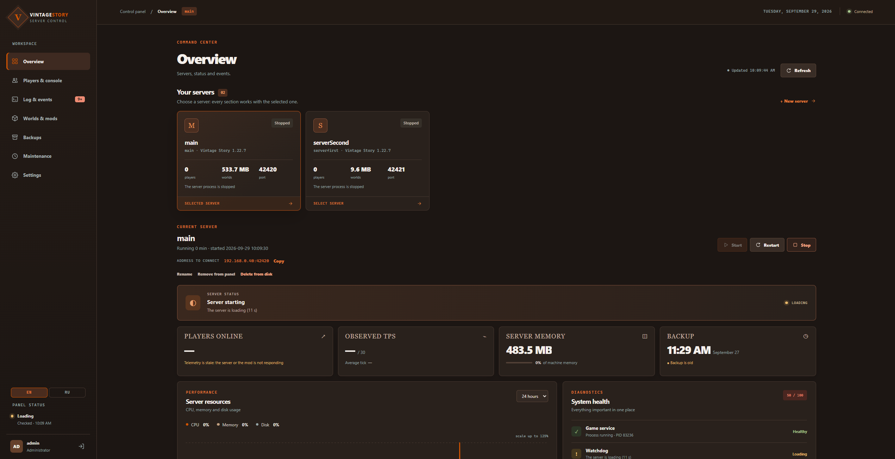
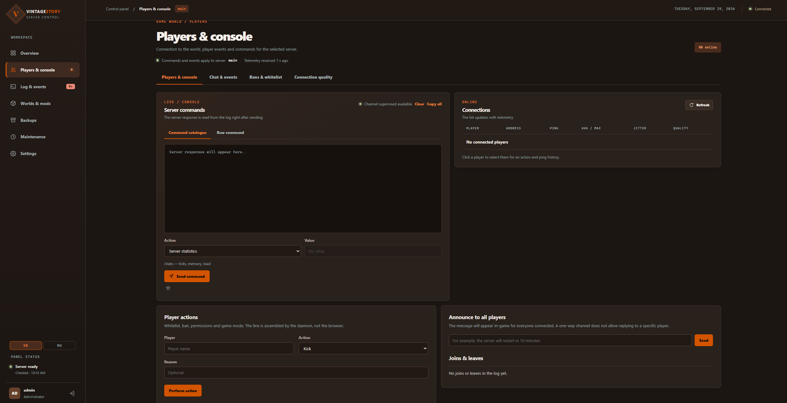
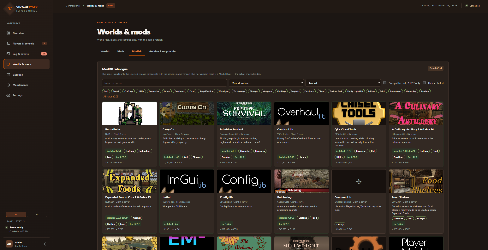
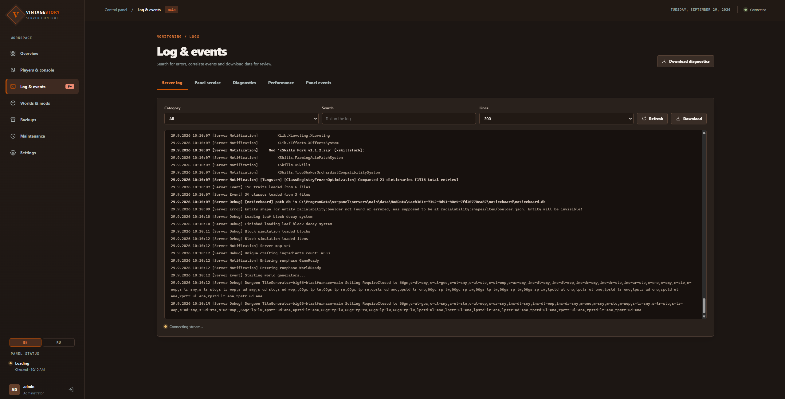
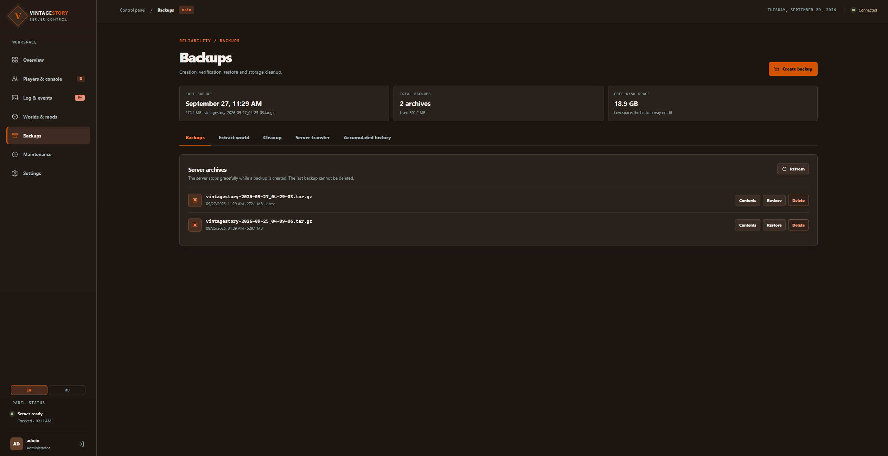
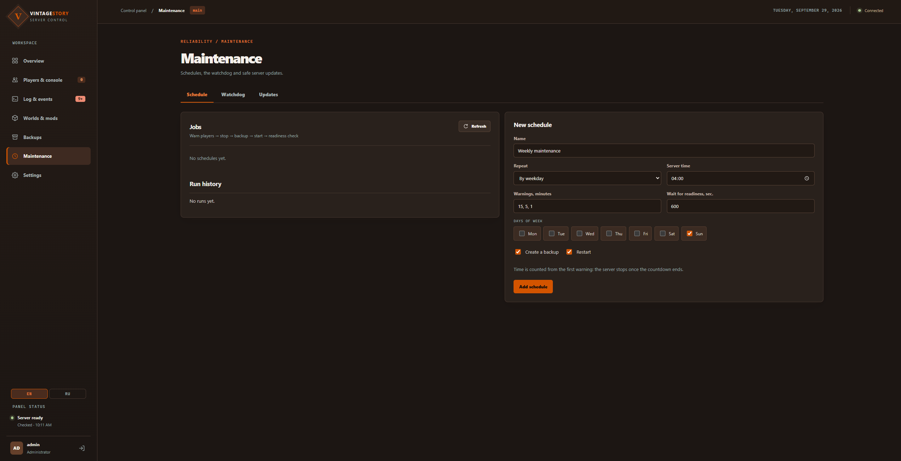
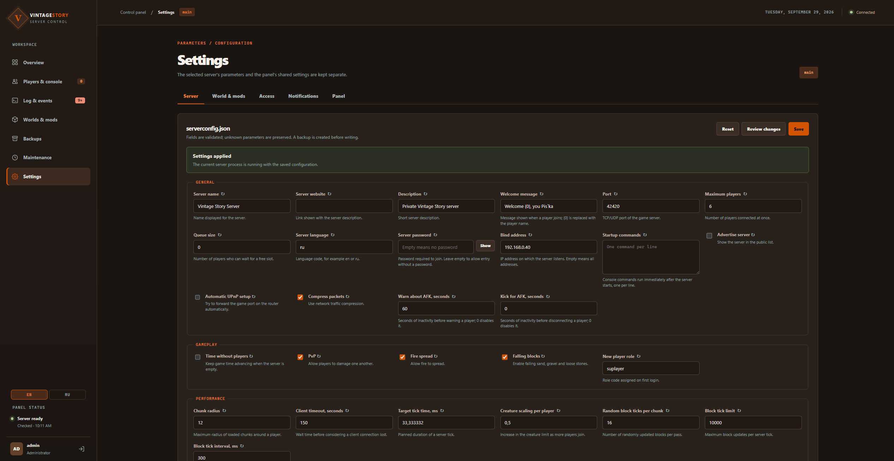
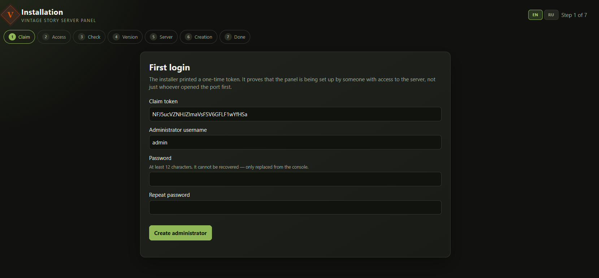

# Vintage Story Panel

[](https://github.com/ruslan120p/vintage-story-panel-net/actions/workflows/ci.yml)
[](LICENSE)
[](https://dotnet.microsoft.com/)


**English** · [Русский](README.ru.md)

A web panel for running dedicated Vintage Story servers. Start and stop, console,
players, worlds, mods, backups, settings and updates — all in the browser, with no
command line on the server.

Runs on Linux and Windows. One panel manages several game servers on the same machine.
The interface is available in English and Russian.

> [!WARNING]
> **Early release — expect breaking changes.** Settings, stored data and the command line
> may change between versions. Take a backup of your worlds before updating the panel.



## Quick start

There are no ready-made releases yet: [build the package from source](#building-from-source) first.

**Linux** — copy the `linux-x64` (or `linux-arm64`) directory to the server and run:

```bash
cd linux-x64 && sudo sh install.sh
```

**Windows** — copy the `win-x64` directory to the machine and double-click `install.cmd`.

The installer prints a one-time link to the [setup wizard](#setup-wizard): create the
administrator account there, and the panel is ready. Details — in [Installation](#installation).

## Features

**Overview.** The list of servers and the state of the selected one: is it running, is it
ready to accept players, how many are online, how loaded it is. Start, stop and restart
with one button. Creating a new server: the panel downloads the official game package
itself, verifies its checksum and prepares the directories.

**Players and console.** Who is online and how good their connection is. Chat and game
events. Ready-made console commands from a catalogue: kick, ban, whitelist, granting
roles. Administrators also get a free-form game console; every command is recorded in the
audit log.

**Log and events.** The server log in real time, with categories and a crash summary. The
panel's own log. A diagnostic bundle for support, with passwords and keys stripped out.
Performance charts. A feed of panel events.

**Worlds and mods.**
- Worlds: create, upload, download, copy, switch; an archive and a recycle bin, so that
  deleted worlds can be brought back.
- Mods: upload, enable and disable, roll back to the previous version, mod packs. The
  panel checks that every mod dependency is present and that the versions fit.
- ModDB: search for mods and install them in one click. The panel shows only releases
  compatible with the server's game version and checks compatibility again on download.

**Backups.** On demand and on a schedule, restore everything or just the world,
cleanup rules for old backups.

**Maintenance.**
- Scheduled restarts and backups, with a warning to players in chat.
- Watchdog: makes sure the server actually responds and restarts it when it hangs — no
  more often than a set limit.
- Updates for mods and for the game itself. Before updating the game the panel takes a
  snapshot of the server program, so the update can be rolled back.

**Settings.**
- `serverconfig.json` as a form split into sections: the panel shows what will change
  before saving and lets you revert a change. Everything else — in a JSON editor.
- The template for new worlds and the settings of the running world.
- Mod settings.
- Accounts and roles, two-factor sign-in.
- Notifications to Discord, Telegram or your own address (webhook).

### Roles

| Role | Can |
|---|---|
| Viewer | See the state, the log and the settings. Does not see players' IP addresses. |
| Operator | Everything a viewer can, plus control the server, players, worlds, mods and backups. |
| Administrator | Everything, plus accounts, creating and deleting servers, the free-form game console, panel settings. |

An action that cannot be undone (deleting a world, a server, a backup) asks you to type a
confirmation phrase.

### Screenshots

| | |
|---|---|
|  |  |
| **Players & console** | **Worlds & mods** — ModDB |
|  |  |
| **Log & events** | **Backups** |
|  |  |
| **Maintenance** | **Settings** |
|  | |
| **Setup wizard** | |

## Requirements

**Linux**
- A 64-bit x86-64 or ARM64 system with systemd (Debian, Ubuntu and the like).
- The `setpriv` utility (package `util-linux`, usually already installed). The game is
  started through it as a separate unprivileged user, never as root.
- Root access for installation.

**Windows**
- Windows 10, 11 or Windows Server, 64-bit.
- Administrator rights for installation.
- Servers on a local NTFS drive.

**Both:** internet access to download the game and mods. The installer sets up the .NET
runtime for the game itself; the panel does not need a separate .NET installation.

## Installation

You get a ready installation directory: `linux-x64`, `linux-arm64` or `win-x64`. If you
build the project yourself, [publish the package](docs/development.md#поставка) first:
a plain `dotnet build` does not update `artifacts`. Run the installer from the published
directory, not from `bin/Debug`.

### Linux

Copy the directory to the server and run the installer:

```bash
scp -r linux-x64 server:vs-panel
ssh server
cd vs-panel && sudo sh install.sh
```

The installer asks where to keep game servers (Enter — `/srv/vs-panel`). Then it creates
the services and the first server, opens the panel port to the local network and prints a
one-time link to the setup wizard — both on this machine and at its network addresses.

To skip the questions:
- `--servers-dir <directory>` — where to keep servers;
- `VS_PANEL_CREATE_SERVER=0` — do not create the first server, create it in the wizard.

Who can reach the panel is set here as well — see [Panel access](#panel-access):

```bash
sudo sh install.sh --access internet      # open to the internet as well
sudo sh install.sh --access localhost     # this machine only, sign in over an SSH tunnel
```

### Windows

Copy the `win-x64` directory to the machine and double-click `install.cmd` in it. It asks
for administrator rights. To publish from source on Windows, use PowerShell or CMD as
described in the [developer notes](docs/development.md#поставка); `install.cmd` only
installs a ready package.

On first installation a folder picker opens for game servers. "Cancel" keeps
`C:\ProgramData\vs-panel\servers`. A folder right at the root of a drive is best, for
example `D:\vs-servers`: a path without spaces, a new or empty folder.

The installer:
- installs two Windows services, `vs-panel-agent` and `vs-panel`, starting automatically
  and restarting on failure;
- creates the first server and opens a firewall rule for its port;
- opens the panel port to the local subnet, so the panel is reachable from other
  computers on the network;
- puts a "Vintage Story Panel" shortcut in the Start menu and on the desktop;
- opens the setup wizard in the browser.

`install.cmd` options (from an administrator command prompt in the installation directory):

| Option | Effect |
|---|---|
| `--servers-dir D:\vs-servers` | where to keep servers, without the folder picker |
| `--no-server` | do not create the first server, create it in the wizard |
| `--no-browser` | do not open the browser, only print the link |
| `--skip-dotnet` | do not install the .NET runtime for the game |
| `--access lan\|internet\|localhost` | who can reach the panel, see [Panel access](#panel-access) |

> The services and game servers run as the system account (LocalSystem). The installer
> does not create users, does not ask for a password and does not change the security
> policy. Access to `C:\ProgramData\vs-panel` and to the servers folder stays with the
> system and administrators only.

### Setup wizard

The link from the installer works once. The wizard asks for:
1. the panel administrator account;
2. panel access: address, port, allowed host names, HTTPS-only cookies. What you chose
   during installation is filled in. If you change the address or the port, the firewall
   rule follows automatically;
3. the first server's parameters: name, port, player limit, world, play style — or skip
   it if you will create the server later.

A lost link can be issued again: `sudo vs-panel access` on Linux or `vs-panel access` in
an administrator command prompt on Windows. Once finished, the wizard is closed for good;
from then on you sign in as usual.

## Signing in

After installation the panel opens on the machine itself at **http://localhost:8080**,
and from other computers on the local network at the machine's address, for example
**http://192.168.1.10:8080**. The installer and `vs-panel access` print the addresses.

The interface language is switched in the panel; English is the default.

### Panel access

Who can reach the panel is set on install, update or repair. The options are the same for
`install.sh`, `install.cmd` and `vs-panel install|update|repair`:

| Option | Effect |
|---|---|
| `--access lan` | the panel listens on all addresses and answers to any name, the port is open to the local network (default) |
| `--access internet` | the same, but the port is open to everyone, the internet included |
| `--access localhost` | this machine only; from another computer — over an SSH tunnel |
| `--port <port>` | panel port |
| `--bind <address>` | the address the panel listens on, if you need one specific address |
| `--allowed-hosts <names>` | comma-separated names and addresses the panel may be reached by; `*` — any |
| `--secure-cookie true` | sign-in over HTTPS only; needs an HTTPS proxy in front of the panel |
| `--firewall lan\|internet\|off` | whom to open the port to; `off` — leave the firewall alone |
| `--trusted-proxies <list>` | reverse proxies whose `X-Forwarded-For` is trusted, see [HTTPS with Caddy](#https-with-caddy) |

Options can be combined: `--access internet --port 9000`. Instead of options you can use
the variables `VS_PANEL_ACCESS`, `VS_PANEL_PORT`, `VS_PANEL_BIND`,
`VS_PANEL_ALLOWED_HOSTS`, `VS_PANEL_SECURE_COOKIE`, `VS_PANEL_FIREWALL`,
`VS_PANEL_TRUSTED_PROXIES`.

To change access for an installed panel:

```bash
sudo vs-panel repair --access internet     # Linux
vs-panel repair --access internet          # Windows, administrator command prompt
```

Settings you do not pass stay as they are. An update without options keeps access as it was.

**Firewall.** The installer opens the panel port in ufw on Linux (if ufw is enabled) and in
Windows Firewall. For the local network on Linux these are the private ranges
`10.0.0.0/8`, `172.16.0.0/12` and `192.168.0.0/16`; on Windows — "local subnet". If the
system uses another firewall (firewalld, nftables), open the port there yourself and
install the panel with `--firewall off`. Access from the internet behind a router also
needs port forwarding to the machine.

> **The panel speaks plain HTTP.** On the local network the password and the session travel
> in clear text. For access from the internet put HTTPS in front of the panel (nginx, Caddy
> and the like) and enable `--secure-cookie true`. Otherwise keep `--access lan` or
> `--access localhost`.

#### HTTPS with Caddy

[Caddy](https://caddyserver.com/) gets a certificate on its own; it
needs a domain name pointing at the machine and ports 80 and 443 open. The whole
`/etc/caddy/Caddyfile`:

```
panel.example.com {
	reverse_proxy 127.0.0.1:8080
}
```

The panel then listens on the machine only and trusts the domain name:

```bash
sudo vs-panel repair --access localhost --allowed-hosts panel.example.com --secure-cookie true
```

**Visitor addresses.** Behind a proxy the panel takes the visitor's address from
`X-Forwarded-For` — for the audit log and for the limit on failed sign-ins. It believes the
header only when the connection itself comes from a trusted proxy; by default that is a
proxy on the same machine (`127.0.0.1,::1`). If the proxy runs on another machine — a
router, a separate nginx — name its address or network:

```bash
sudo vs-panel repair --trusted-proxies 127.0.0.1,::1,10.0.0.2
```

List only your own proxies, never the networks your visitors come from: anyone connecting
from a trusted address can put any address into the header.

An **SSH tunnel** is the safest option: the panel listens on the machine only, nothing is
exposed.

```bash
ssh -L 8080:localhost:8080 server
# then open http://localhost:8080 in the browser
```

### Settings file

All of this lives in `/etc/vs-panel.env` on Linux and `C:\ProgramData\vs-panel\vs-panel.env`
on Windows. You can edit the file by hand and then restart the panel (`vs-panel restart`).
A manual edit does not update the firewall rule: run `vs-panel repair`.

| Setting | Default | Meaning |
|---|---|---|
| `PANEL_BIND` | `0.0.0.0` | the address the panel listens on; `127.0.0.1` — this machine only |
| `PANEL_PORT` | `8080` | panel port |
| `PANEL_ALLOWED_HOSTS` | `*` | host names the panel may be reached by |
| `PANEL_SECURE_COOKIE` | `false` | sign-in over HTTPS only |
| `PANEL_FIREWALL` | `lan` | whom the panel port is open to: `lan`, `internet` or `off` |
| `PANEL_SESSION_HOURS` | `12` | how long a sign-in lasts |
| `PANEL_MAX_UPLOAD_MB` | `256` | upload limit for a mod or a file |
| `PANEL_MAX_WORLD_UPLOAD_MB` | `4096` | upload limit for a world |
| `PANEL_AUDIT_RETENTION_DAYS` | `90` | how long to keep the audit log |
| `PANEL_TRUSTED_PROXIES` | `127.0.0.1,::1` | reverse proxies whose `X-Forwarded-For` is trusted: addresses and networks such as `10.0.0.0/8` |

## Command line

On Linux — with `sudo`; on Windows — in an administrator command prompt, without `sudo`.
After installing on Windows open a new window: the `vs-panel` command appears there.

| Command | Effect |
|---|---|
| `vs-panel status` | state of the services and the panel address |
| `vs-panel access` | panel addresses on the machine and on the network; before the wizard — a new link to it |
| `vs-panel password` | a new password for the `admin` account, if it is forgotten |
| `vs-panel start`, `stop`, `restart` | start, stop, restart the panel |
| `vs-panel doctor` | check the installation without changing anything |
| `vs-panel update --from <directory>` | install a new version |
| `vs-panel rollback` | return to the previous version |
| `vs-panel repair` | restore services and file permissions; with `--access` — change panel access |
| `vs-panel logs` | service log |
| `vs-panel servers` | list of game servers |
| `vs-panel uninstall` | remove the panel |
| `vs-panel help` | all commands |

### Updating

Publish a fresh package (or get a ready installation directory), copy it to the machine
and run:

```bash
sudo vs-panel update --from ./linux-x64
```

On Windows — in PowerShell as administrator:

```powershell
vs-panel update --from 'D:\path\to\win-x64'
```

Accounts, servers, worlds and settings are kept. The two previous versions are stored;
`vs-panel rollback` returns to the latest of them. After an interface update, reload the
open browser tab so that it picks up the icon and styles.

### Uninstalling

`vs-panel uninstall` removes the panel services and the firewall rule for its port: the
program, accounts and settings stay, and the panel can be installed again. With `--purge`
the program, the panel data and its settings are removed as well.

Game servers — their program, worlds and backups — are not touched when the panel is
removed. To delete a server completely, do it in the panel before removing the panel. On
Windows `--purge` does not remove the firewall rule for the game port or the .NET runtime
for the game.

## Where things are

| | Linux | Windows |
|---|---|---|
| Program | `/opt/vs-panel` | `C:\Program Files\vs-panel` |
| Panel settings | `/etc/vs-panel.env`, `/etc/vs-panel.json` | `C:\ProgramData\vs-panel\vs-panel.env`, `vs-panel.json` |
| Server registry | `/etc/vs-panel/instances.json` | `C:\ProgramData\vs-panel\instances.json` |
| Panel data | `/var/lib/vs-panel` | `C:\ProgramData\vs-panel\state` |
| Game servers | the chosen directory, `/srv/vs-panel` by default | the chosen folder, `C:\ProgramData\vs-panel\servers` by default |
| Service log | `journalctl -u vs-panel -u vs-panel-agent` | Event Viewer → Windows Logs → Application |

Each server has its own directory: `server` — the game program, `data` — worlds, mods and
settings, `backups` — backups. An administrator changes the folder for new servers in
Settings → Panel. Servers that already exist stay where they are.

## Troubleshooting

1. `vs-panel doctor` checks the services, files, permissions and panel reachability and
   tells you what is wrong.
2. `vs-panel status` — whether the services are running and at what address the panel is.
3. In the panel: Log & events → Diagnostics → download the diagnostic bundle. Passwords and
   keys are stripped from it, so it is safe to share.

If installation stopped with an error, save its output and the output of `vs-panel doctor`.

## How it works and security

The panel is two processes:
- **the web panel** (`vs-panel-web`) serves the interface. On Linux it runs as the
  unprivileged `vs-panel` user and has no access to game directories;
- **the agent** (`vs-panel-agent`) does everything that needs privileges: services, game
  files, the firewall. It runs as root on Linux and as LocalSystem on Windows.

The panel sends the agent only a server ID and an operation; the agent works out every
path itself from its own registry. It answers only the panel: on Linux it checks the
caller's user ID on its Unix socket (`SO_PEERCRED`), on Windows its named pipe is open to
the service account and administrators only.

- The game never runs as root: on Linux it is started as a separate `vsgame` user.
- An uploaded archive is judged as a whole — every path and link in it — before anything
  is extracted.
- Passwords are hashed with scrypt; two-factor sign-in (TOTP) is available.
- Changes made through the panel are recorded in the audit log; the free-form game console
  is for administrators only, and every line sent to it is recorded in full.

## Reporting problems

Open an [issue](https://github.com/ruslan120p/vintage-story-panel-net/issues) with:
- the operating system and the panel version (`vs-panel version`);
- what you did and what happened;
- the output of `vs-panel doctor` and, if possible, the diagnostic bundle (see
  [Troubleshooting](#troubleshooting)).

Please report security problems privately, through
[a security advisory](https://github.com/ruslan120p/vintage-story-panel-net/security/advisories/new),
not in a public issue.

Pull requests are welcome. For anything larger than a fix, open an issue first so we can
agree on the approach.

## Building from source

You need the [.NET SDK 10](https://dotnet.microsoft.com/download). The tests need no game
server and run on Linux and Windows:

```bash
dotnet build
dotnet test
```

To build an installation package (self-contained, no .NET needed on the target machine):

```bash
bash scripts/publish.sh linux-x64      # or linux-arm64
```

```powershell
.\scripts\publish.ps1 win-x64
```

The package lands in `artifacts/<target>` — that is the directory the installer runs
from. Style follows `.editorconfig`; check it with
`dotnet format whitespace --verify-no-changes`. How the code is organised, the rules the
tests enforce and how the installer works — in [docs/development.md](docs/development.md)
(in Russian).

## License

[MIT](LICENSE).

Vintage Story Panel is an independent project. It is not affiliated with, endorsed by or
supported by Anapoly Games, the developer of Vintage Story.
