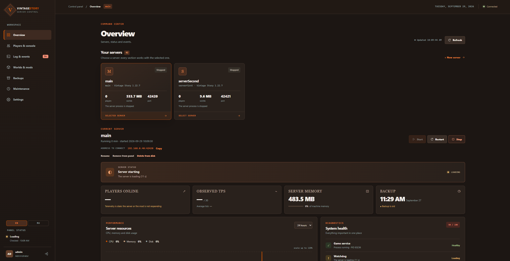
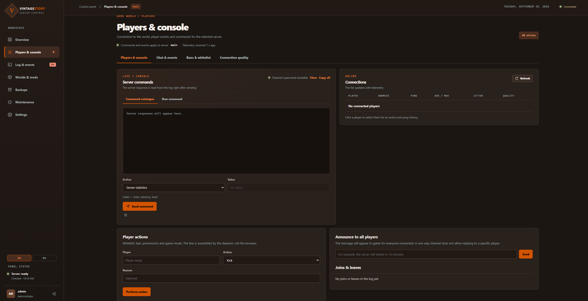
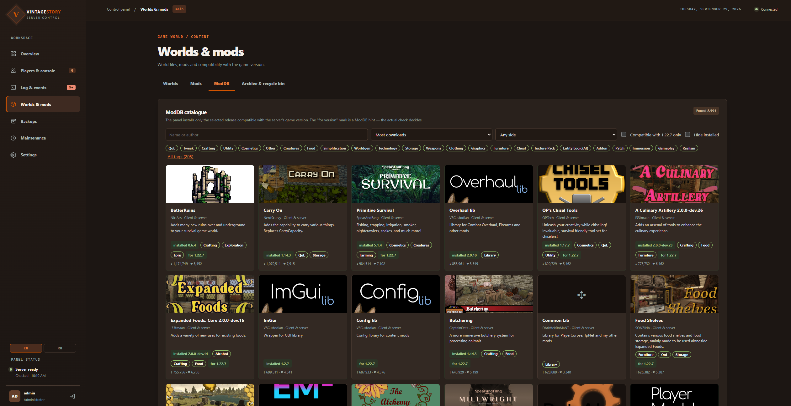
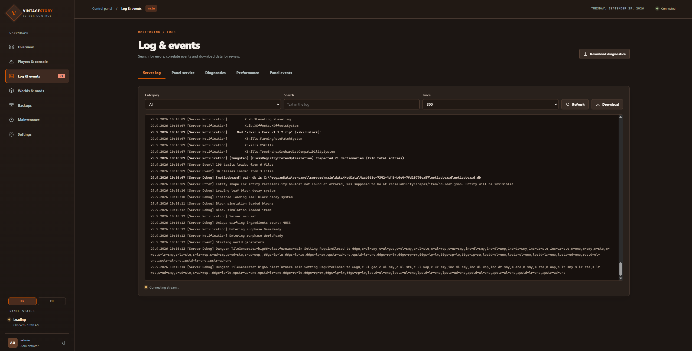
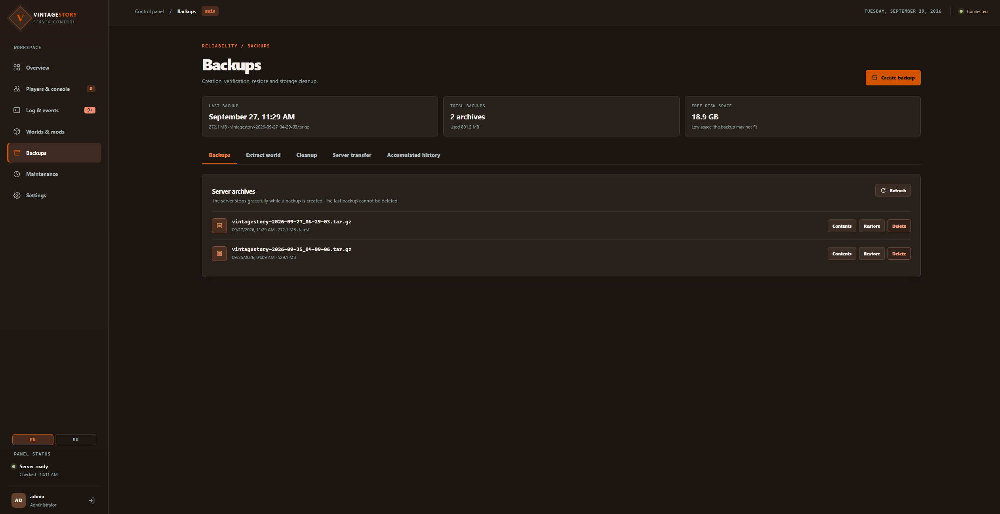
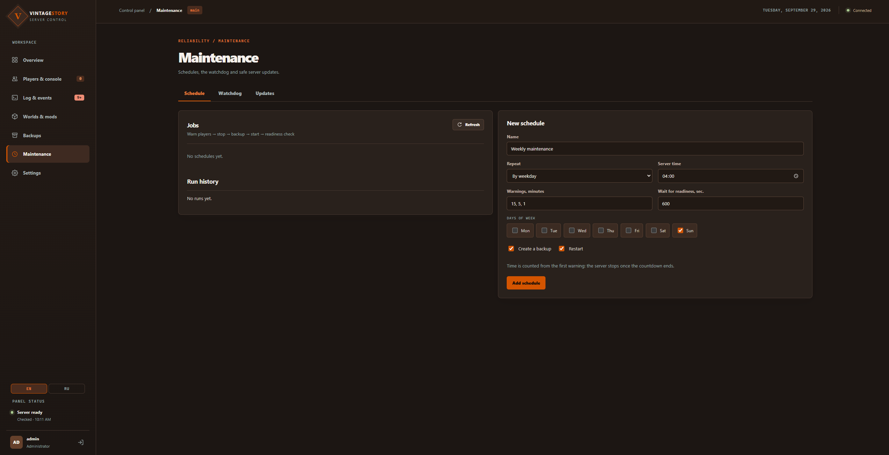
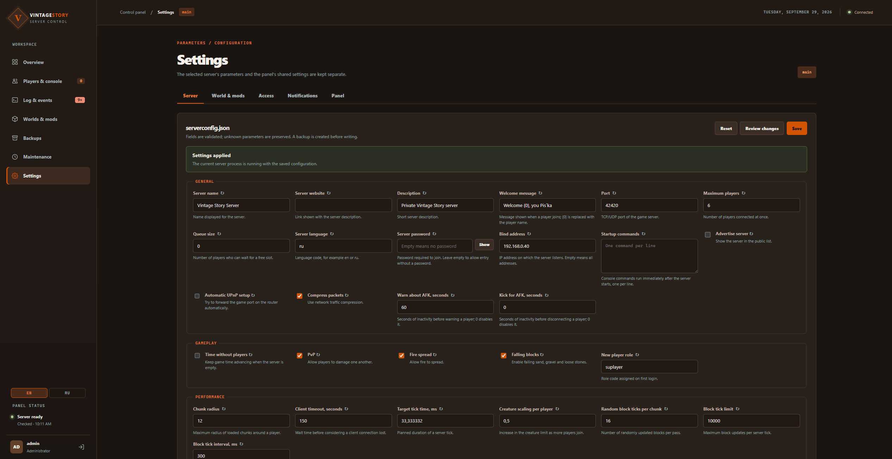
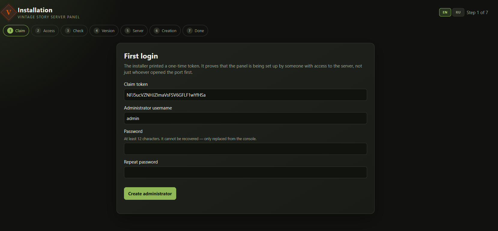

# Vintage Story Panel

[](https://github.com/ruslan120p/vintage-story-panel-net/actions/workflows/ci.yml)
[](LICENSE)
[](https://dotnet.microsoft.com/)


[English](README.md) · **Русский**

Веб-панель для управления выделенными серверами Vintage Story. Запуск и остановка,
консоль, игроки, миры, моды, резервные копии, настройки и обновления — в браузере,
без командной строки на сервере.

Работает на Linux и на Windows. Одна панель управляет несколькими игровыми серверами
на одной машине.
Интерфейс — на английском и русском.

> [!WARNING]
> **Ранняя версия — возможны несовместимые изменения.** Настройки, хранимые данные и
> команды терминала могут меняться между версиями. Перед обновлением панели сделайте
> резервную копию миров.



## Быстрый старт

**Linux** — одна команда на сервере:

```bash
curl -fsSL https://raw.githubusercontent.com/ruslan120p/vintage-story-panel-net/master/deploy/get.sh | sudo sh
```

**Windows** — одна команда в PowerShell:

```powershell
irm https://raw.githubusercontent.com/ruslan120p/vintage-story-panel-net/master/deploy/windows/get.ps1 | iex
```

Команда скачивает пакет последнего релиза для этой машины и запускает установщик.

Установщик выведет одноразовую ссылку на [мастер установки](#мастер-установки): создайте
в нём учётную запись администратора, и панель готова. Подробности — в [Установке](#установка).

## Возможности

**Обзор.** Список серверов и состояние выбранного: запущен ли, готов ли принимать
игроков, сколько их в игре, нагрузка. Запуск, остановка и перезапуск одной кнопкой.
Создание нового сервера: панель сама скачивает официальный пакет игры, сверяет его
контрольную сумму и готовит каталоги.

**Игроки и консоль.** Кто в игре и какое у него соединение. Чат и игровые события.
Готовые консольные команды из каталога: кик, бан, белый список, выдача прав. У
администратора — свободная консоль игры; каждая команда записывается в журнал аудита.

**Журнал и события.** Журнал сервера в реальном времени, с категориями и сводкой
сбоев. Журнал самой панели. Диагностический пакет для поддержки: пароли и ключи из
него удаляются. Графики производительности. Лента событий панели.

**Миры и моды.**
- Миры: создание, загрузка, скачивание, копирование, переключение; архив и корзина,
  чтобы удалённое можно было вернуть.
- Моды: загрузка, включение и выключение, откат к предыдущей версии, наборы модов.
  Панель проверяет, все ли зависимости модов на месте и подходят ли их версии.
- ModDB: поиск модов и установка в один щелчок. Панель показывает только релизы,
  совместимые с версией игры на сервере, и ещё раз проверяет совместимость при
  скачивании.

**Резервные копии.** Копия по кнопке и по расписанию, восстановление целиком или
только мира, правила очистки старых копий.

**Обслуживание.**
- Расписание перезапусков и копий с предупреждением игроков в чате.
- Наблюдатель: следит, что сервер действительно отвечает, и при зависании
  перезапускает его — не чаще заданного предела.
- Обновление модов и самой игры. Перед обновлением игры панель делает снимок
  программы сервера, так что обновление можно откатить.

**Настройки.**
- `serverconfig.json` формой по разделам: панель показывает, что изменится, до
  сохранения, и позволяет откатить изменение. Остальные параметры — в редакторе JSON.
- Шаблон нового мира и параметры работающего мира.
- Настройки модов.
- Учётные записи и роли, двухфакторный вход.
- Уведомления в Discord, Telegram или на свой адрес (вебхук).

### Роли

| Роль | Что может |
|---|---|
| Наблюдатель | Смотреть состояние, журнал и настройки. Не видит IP-адреса игроков. |
| Оператор | Всё, что наблюдатель, плюс управлять сервером, игроками, мирами, модами и копиями. |
| Администратор | Всё, плюс учётные записи, создание и удаление серверов, свободная консоль игры, настройки панели. |

Действие, которое нельзя отменить (удаление мира, сервера, копии), требует ввести
подтверждающую фразу.

### Скриншоты

Интерфейс на снимках — английский; русский включается переключателем в панели.

| | |
|---|---|
|  |  |
| **Игроки и консоль** | **Миры и моды** — ModDB |
|  |  |
| **Журнал и события** | **Резервные копии** |
|  |  |
| **Обслуживание** | **Настройки** |
|  | |
| **Мастер установки** | |

## Требования

**Linux**
- 64-битная система x86-64 или ARM64 с systemd (Debian, Ubuntu и подобные).
- Утилита `setpriv` (пакет `util-linux`, обычно уже установлен). Игра запускается
  через неё от отдельного непривилегированного пользователя, а не от root.
- Права root для установки.

**Windows**
- Windows 10, 11 или Windows Server, 64-битная.
- Права администратора для установки.
- Серверы — на локальном диске NTFS.

**Обе системы:** доступ в интернет для скачивания игры и модов. Среду .NET для игры
установщик ставит сам; отдельно ставить .NET для панели не нужно.

### Ресурсы панели и игровых серверов

Панель и игровые серверы работают на одной машине. Основная нагрузка приходится
на игру; ресурсы ниже нужно закладывать для всех одновременно запущенных серверов.

Для панели и демона без запущенной игры ориентируйтесь на 1–2 современных ядра,
0,5–1 ГБ RAM сверх потребностей ОС и 2–3 ГБ диска под установку, обновления и журналы.
Это оценка для планирования, а не измеренный минимум: нагрузочные замеры панели
пока не зафиксированы.

[Официальный ориентир Vintage Story](https://www.vintagestory.at/selfhosting/) —
1 ГБ RAM на игровой сервер плюс 300 МБ на каждого одновременно играющего;
рекомендуются 4 потока CPU. Моды и активное исследование мира увеличивают нагрузку.

Практические рекомендации с запасом для **всей машины: ОС, панель и один игровой сервер**:

| Нагрузка | CPU | Общая RAM | Место на SSD под сервер и копии |
|---|---|---|---|
| 2–5 игроков, без тяжёлых модов | 4 быстрых потока | 8 ГБ | от 40–60 ГБ |
| 5–10 игроков, умеренные моды | 4–6 быстрых потоков | 16 ГБ | от 80–100 ГБ |
| 10–20 игроков или тяжёлая сборка модов | 6–8 быстрых потоков | 24–32 ГБ | от 150 ГБ |

Это стартовые ориентиры, не гарантия для любой сборки модов. Место на диске зависит
от роста мира и числа хранимых резервных копий. Для нескольких серверов складывайте
их потребности в RAM и оставляйте запас ОС и панели; CPU подбирайте под одновременную
нагрузку. Например, для двух серверов по 5 игроков разумный старт — 6–8 быстрых
потоков, 16 ГБ RAM и SSD с 150–200 ГБ свободного места; с тяжёлыми модами — 32 ГБ RAM.

Для нескольких игровых серверов нужны разные порты. Интернет требуется для
скачивания игры и модов; для доступа игроков извне нужен доступный игровой порт
(проброс на роутере при необходимости). Порт панели по умолчанию — 8080,
первого игрового сервера — 42420.

## Установка

Установка — одна команда: она берёт пакет последнего [релиза](https://github.com/ruslan120p/vintage-story-panel-net/releases)
для этой машины (`linux-x64`, `linux-arm64` или `win-x64`), сверяет его с `SHA256SUMS`
релиза и запускает установщик из него. Определённый релиз задаёт переменная
`VS_PANEL_VERSION`, например `VS_PANEL_VERSION=0.3.0`. Если собираете проект сами,
установщик запускается из [опубликованного пакета](#из-каталога-сборки).

### Linux

```bash
curl -fsSL https://raw.githubusercontent.com/ruslan120p/vintage-story-panel-net/master/deploy/get.sh | sudo sh
```

Нужны `curl` или `wget`, `tar` и `sha256sum` — в Debian и Ubuntu они есть сразу.

Установщик спросит, где хранить игровые серверы (Enter — `/srv/vs-panel`). Затем он
создаёт службы и первый сервер, открывает порт панели для локальной сети и печатает
одноразовую ссылку на мастер установки — и на этой машине, и по её адресам в сети.

Чтобы не отвечать на вопросы:
- `--servers-dir <каталог>` — где хранить серверы;
- `VS_PANEL_CREATE_SERVER=0` — не создавать первый сервер, создать его в мастере.

Ключи установщика передаются после `sh -s --`. Кому видна панель, задаётся тут же — см.
[Доступ к панели](#доступ-к-панели):

```bash
curl -fsSL …/deploy/get.sh | sudo sh -s -- --access internet    # открыть и для интернета
curl -fsSL …/deploy/get.sh | sudo sh -s -- --access localhost   # только эта машина, вход через SSH-туннель
curl -fsSL …/deploy/get.sh | sudo VS_PANEL_VERSION=0.3.0 sh     # определённый релиз
```

### Windows

В PowerShell:

```powershell
irm https://raw.githubusercontent.com/ruslan120p/vintage-story-panel-net/master/deploy/windows/get.ps1 | iex
```

Если PowerShell открыт не от имени администратора, команда попросит права и продолжит в
новом окне. Ключи установщика передаются так:

```powershell
& ([scriptblock]::Create((irm https://raw.githubusercontent.com/ruslan120p/vintage-story-panel-net/master/deploy/windows/get.ps1))) --access internet
```

Определённый релиз — `$env:VS_PANEL_VERSION = '0.3.0'` перед командой.

При первой установке откроется окно выбора папки для игровых серверов. «Отмена»
оставляет `C:\ProgramData\vs-panel\servers`. Лучше выбрать папку прямо в корне диска,
например `D:\vs-servers`: путь без пробелов, папка новая или пустая.

Установщик:
- ставит две службы Windows, `vs-panel-agent` и `vs-panel`, с автозапуском и
  перезапуском при сбое;
- создаёт первый сервер и открывает правило брандмауэра для его порта;
- открывает порт панели для локальной подсети, чтобы панель была видна с других
  компьютеров в сети;
- кладёт ярлык «Vintage Story Panel» в меню «Пуск» и на рабочий стол;
- открывает в браузере мастер установки.

Ключи установщика (те же у `get.ps1` и `install.cmd`):

| Ключ | Действие |
|---|---|
| `--servers-dir D:\vs-servers` | где хранить серверы, без окна выбора |
| `--no-server` | не создавать первый сервер, создать его в мастере |
| `--no-browser` | не открывать браузер, только напечатать ссылку |
| `--skip-dotnet` | не ставить среду .NET для игры |
| `--access lan\|internet\|localhost` | кому видна панель, см. [Доступ к панели](#доступ-к-панели) |

> Службы и игровые серверы работают от системной учётной записи (LocalSystem).
> Установщик не создаёт пользователей, не спрашивает пароль и не меняет политику
> безопасности. Доступ к `C:\ProgramData\vs-panel` и к папке серверов остаётся только
> у системы и администраторов.

### Из каталога сборки

Без доступа к GitHub или со своей сборкой установщик запускается из каталога пакета:
[опубликуйте его](docs/development.md#поставка) (`dotnet build` не обновляет `artifacts`)
или распакуйте архив релиза, скопируйте на машину и запустите в нём `sudo sh install.sh`
на Linux или `install.cmd` на Windows. Ключи те же.

### Мастер установки

Ссылка из установщика одноразовая. Мастер спрашивает:
1. учётную запись администратора панели;
2. доступ к панели: адрес, порт, разрешённые имена хостов, куки только по HTTPS.
   Сразу подставлено то, что выбрано при установке. Если сменить адрес или порт,
   правило брандмауэра переставится само;
3. параметры первого сервера: название, порт, число игроков, мир, стиль игры —
   или пропуск, если сервер создадите позже.

Потерянную ссылку можно получить заново: `sudo vs-panel access` на Linux или
`vs-panel access` в командной строке администратора на Windows. После завершения
мастер закрывается навсегда, дальше — обычный вход.

## Вход в панель

После установки панель открывается на самой машине по адресу **http://localhost:8080**,
а с других компьютеров локальной сети — по адресу машины, например
**http://192.168.1.10:8080**. Адреса печатают установщик и `vs-panel access`.

Язык интерфейса переключается в самой панели; по умолчанию — английский.

### Доступ к панели

Кому видна панель, задаётся при установке, обновлении или восстановлении. Ключи
одинаковы для `install.sh`, `install.cmd` и `vs-panel install|update|repair`:

| Ключ | Что делает |
|---|---|
| `--access lan` | панель слушает все адреса и отвечает по любому имени, порт открыт локальной сети (по умолчанию) |
| `--access internet` | то же, но порт открыт всем, включая интернет |
| `--access localhost` | только эта машина; с другого компьютера — через SSH-туннель |
| `--port <порт>` | порт панели |
| `--bind <адрес>` | адрес, на котором слушает панель, если нужен один конкретный |
| `--allowed-hosts <имена>` | имена и адреса через запятую, по которым можно обращаться к панели; `*` — любые |
| `--secure-cookie true` | вход только по HTTPS; нужен HTTPS-прокси перед панелью |
| `--firewall lan\|internet\|off` | кому открыть порт; `off` — брандмауэр не трогать |
| `--trusted-proxies <список>` | обратные прокси, чьему `X-Forwarded-For` панель верит, см. [HTTPS через Caddy](#https-через-caddy) |

Ключи можно сочетать: `--access internet --port 9000`. Вместо ключей подойдут
переменные `VS_PANEL_ACCESS`, `VS_PANEL_PORT`, `VS_PANEL_BIND`,
`VS_PANEL_ALLOWED_HOSTS`, `VS_PANEL_SECURE_COOKIE`, `VS_PANEL_FIREWALL`,
`VS_PANEL_TRUSTED_PROXIES`.

Чтобы поменять доступ у уже установленной панели:

```bash
sudo vs-panel repair --access internet     # Linux
vs-panel repair --access internet          # Windows, командная строка администратора
```

Незаданные настройки не меняются. Обновление без ключей оставляет доступ таким,
каким он был.

**Брандмауэр.** Установщик открывает порт панели в ufw на Linux (если ufw включён) и в
брандмауэре Windows. Для локальной сети на Linux это частные диапазоны `10.0.0.0/8`,
`172.16.0.0/12` и `192.168.0.0/16`, на Windows — «локальная подсеть». Если в системе
другой брандмауэр (firewalld, nftables), откройте порт в нём сами и ставьте панель с
`--firewall off`. Для доступа из интернета за роутером нужен ещё проброс порта на машину.

> **Панель работает по HTTP.** В локальной сети пароль и сессия идут открытым
> текстом. Для доступа из интернета поставьте перед панелью HTTPS (nginx, Caddy и
> подобные) и включите `--secure-cookie true`. Иначе оставьте `--access lan` или
> `--access localhost`.

#### HTTPS через Caddy

[Caddy](https://caddyserver.com/) сам получает сертификат; нужно
доменное имя, указывающее на машину, и открытые порты 80 и 443. Весь
`/etc/caddy/Caddyfile`:

```
panel.example.com {
	reverse_proxy 127.0.0.1:8080
}
```

Панель при этом слушает только машину и доверяет доменному имени:

```bash
sudo vs-panel repair --access localhost --allowed-hosts panel.example.com --secure-cookie true
```

**Адреса посетителей.** За прокси панель берёт адрес посетителя из `X-Forwarded-For` —
для журнала аудита и для ограничения неудачных попыток входа. Заголовку она верит, только
если само соединение пришло от доверенного прокси; по умолчанию это прокси на той же
машине (`127.0.0.1,::1`). Если прокси на другой машине — роутер, отдельный nginx, —
назовите его адрес или сеть:

```bash
sudo vs-panel repair --trusted-proxies 127.0.0.1,::1,10.0.0.2
```

Указывайте только свои прокси, а не сети, из которых приходят посетители: любой, кто
подключается с доверенного адреса, может вписать в заголовок какой угодно адрес.

**SSH-туннель** — самый безопасный вариант: панель слушает только машину, наружу
ничего не открыто.

```bash
ssh -L 8080:localhost:8080 server
# затем в браузере http://localhost:8080
```

### Файл настроек

Всё это хранится в `/etc/vs-panel.env` на Linux и `C:\ProgramData\vs-panel\vs-panel.env`
на Windows. Файл можно править и вручную, после чего перезапустить панель
(`vs-panel restart`). Правило брандмауэра при ручной правке само не меняется:
выполните `vs-panel repair`.

| Параметр | По умолчанию | Что задаёт |
|---|---|---|
| `PANEL_BIND` | `0.0.0.0` | адрес, на котором слушает панель; `127.0.0.1` — только эта машина |
| `PANEL_PORT` | `8080` | порт панели |
| `PANEL_ALLOWED_HOSTS` | `*` | имена хостов, по которым можно обращаться к панели |
| `PANEL_SECURE_COOKIE` | `false` | вход только по HTTPS |
| `PANEL_FIREWALL` | `lan` | кому открыт порт панели: `lan`, `internet` или `off` |
| `PANEL_SESSION_HOURS` | `12` | сколько живёт вход |
| `PANEL_MAX_UPLOAD_MB` | `256` | предел загрузки мода или файла |
| `PANEL_MAX_WORLD_UPLOAD_MB` | `4096` | предел загрузки мира |
| `PANEL_AUDIT_RETENTION_DAYS` | `90` | сколько хранить журнал аудита |
| `PANEL_TRUSTED_PROXIES` | `127.0.0.1,::1` | обратные прокси, чьему `X-Forwarded-For` панель верит: адреса и сети вида `10.0.0.0/8` |

## Управление из терминала

На Linux — через `sudo`, на Windows — в командной строке администратора, без `sudo`.
После установки на Windows откройте новое окно: команда `vs-panel` появится в нём.

| Команда | Действие |
|---|---|
| `vs-panel status` | состояние служб и адрес панели |
| `vs-panel access` | адреса панели на машине и в сети; до мастера — новая ссылка на него |
| `vs-panel password` | новый пароль учётной записи `admin`, если он забыт |
| `vs-panel start`, `stop`, `restart` | запустить, остановить, перезапустить панель |
| `vs-panel doctor` | проверить установку, ничего не меняя |
| `vs-panel update` | поставить последний релиз; `--version <версия>` — определённый, `--from <каталог>` — из каталога сборки |
| `vs-panel rollback` | вернуть предыдущую версию |
| `vs-panel repair` | восстановить службы и права файлов; с `--access` — сменить доступ к панели |
| `vs-panel logs` | журнал служб |
| `vs-panel servers` | список игровых серверов |
| `vs-panel uninstall` | удалить панель |
| `vs-panel help` | все команды |

### Обновление

```bash
sudo vs-panel update                     # последний релиз
sudo vs-panel update --version 0.3.0     # определённый релиз
sudo vs-panel update --from ./linux-x64  # свой пакет из каталога сборки
```

На Windows — те же команды в PowerShell от имени администратора, без `sudo`. Если
уже стоит последний релиз или более новая версия, `update` ничего не делает. Команда
установки из [раздела выше](#установка) тоже обновляет уже поставленную панель, а на
Windows ею же переустанавливают ту же версию. Для Windows на ARM пакета пока нет.

Учётные записи, серверы, миры и настройки сохраняются. Хранятся две предыдущие
версии; `vs-panel rollback` возвращает последнюю из них. После обновления интерфейса
перезагрузите открытую вкладку браузера, чтобы он перечитал значок и стили.

### Удаление

`vs-panel uninstall` удаляет службы панели и правило брандмауэра для её порта:
программа, учётные записи и настройки остаются, и панель можно поставить снова. С ключом `--purge` удаляются
также программа, данные панели и её настройки.

Игровые серверы — их программа, миры и копии — при удалении панели не затрагиваются.
Удалить сервер целиком можно в самой панели, до её удаления. На Windows `--purge` не
удаляет правило брандмауэра для игрового порта и среду .NET для игры.

## Где что лежит

| | Linux | Windows |
|---|---|---|
| Программа | `/opt/vs-panel` | `C:\Program Files\vs-panel` |
| Настройки панели | `/etc/vs-panel.env`, `/etc/vs-panel.json` | `C:\ProgramData\vs-panel\vs-panel.env`, `vs-panel.json` |
| Реестр серверов | `/etc/vs-panel/instances.json` | `C:\ProgramData\vs-panel\instances.json` |
| Данные панели | `/var/lib/vs-panel` | `C:\ProgramData\vs-panel\state` |
| Игровые серверы | выбранный каталог, по умолчанию `/srv/vs-panel` | выбранная папка, по умолчанию `C:\ProgramData\vs-panel\servers` |
| Журнал служб | `journalctl -u vs-panel -u vs-panel-agent` | «Просмотр событий» → «Журналы Windows» → «Приложение» |

У каждого сервера свой каталог: `server` — программа игры, `data` — миры, моды и
настройки, `backups` — резервные копии. Папку для новых серверов администратор меняет
в «Настройки» → «Панель». Уже созданные серверы при этом остаются на прежнем месте.

## Если что-то не работает

1. `vs-panel doctor` — проверяет службы, файлы, права и доступность панели и
   говорит, что не так.
2. `vs-panel status` — запущены ли службы и по какому адресу панель.
3. В панели: «Журнал и события» → «Диагностика» → скачать диагностический пакет.
   Пароли и ключи из него удалены, его можно пересылать.

Если установка остановилась с ошибкой, сохраните её вывод и вывод `vs-panel doctor`.

## Как это устроено и безопасность

Панель — это два процесса:
- **веб-панель** (`vs-panel-web`) отдаёт интерфейс. На Linux она работает от
  непривилегированного пользователя `vs-panel` и доступа к игровым каталогам не имеет;
- **демон** (`vs-panel-agent`) делает всё, что требует прав: службы, файлы игры,
  брандмауэр. На Linux он работает от root, на Windows — от LocalSystem.

Панель присылает демону только идентификатор сервера и операцию; все пути демон выводит
сам из своего реестра. Отвечает он только панели: на Linux сверяет идентификатор
пользователя на Unix-сокете (`SO_PEERCRED`), на Windows его именованный канал открыт
только учётной записи службы и администраторам.

- Игра никогда не запускается от root: на Linux — от отдельного пользователя `vsgame`.
- Загруженный архив судится целиком — каждый путь и каждая ссылка в нём — до того, как
  из него что-то распакуется.
- Пароли хранятся хешами scrypt; доступен двухфакторный вход (TOTP).
- Изменения через панель записываются в журнал аудита; свободная консоль игры — только
  для администратора, и каждая отправленная в неё строка записывается целиком.

## Сообщить о проблеме

Откройте [issue](https://github.com/ruslan120p/vintage-story-panel-net/issues) и приложите:
- операционную систему и версию панели (`vs-panel version`);
- что вы делали и что произошло;
- вывод `vs-panel doctor` и, если можно, диагностический пакет (см.
  [Если что-то не работает](#если-что-то-не-работает)).

О проблемах безопасности сообщайте закрыто, через
[security advisory](https://github.com/ruslan120p/vintage-story-panel-net/security/advisories/new),
а не в открытом issue.

Pull request приветствуются. Если правка больше исправления, сначала откройте issue,
чтобы договориться о подходе.

## Сборка из исходников

Нужен [.NET SDK 10](https://dotnet.microsoft.com/download). Тестам не нужен игровой
сервер, они идут на Linux и Windows:

```bash
dotnet build
dotnet test
```

Пакет установки (self-contained, на целевой машине .NET не нужен):

```bash
bash scripts/publish.sh linux-x64      # или linux-arm64
```

```powershell
.\scripts\publish.ps1 win-x64
```

Пакет появится в `artifacts/<цель>` — из этого каталога и запускается установщик. Релиз
публикует тег `v<версия>`, совпадающий с `PanelVersion` в `Directory.Build.props`. Стиль
задаёт `.editorconfig`, проверка — `dotnet format whitespace --verify-no-changes`.
Устройство кода, правила, которые проверяют тесты, и работа установщика — в
[docs/development.md](docs/development.md).

## Лицензия

[MIT](LICENSE).

Vintage Story Panel — независимый проект. Он не связан с Anapoly Games, разработчиком
Vintage Story, и не одобрен и не поддерживается ею.
