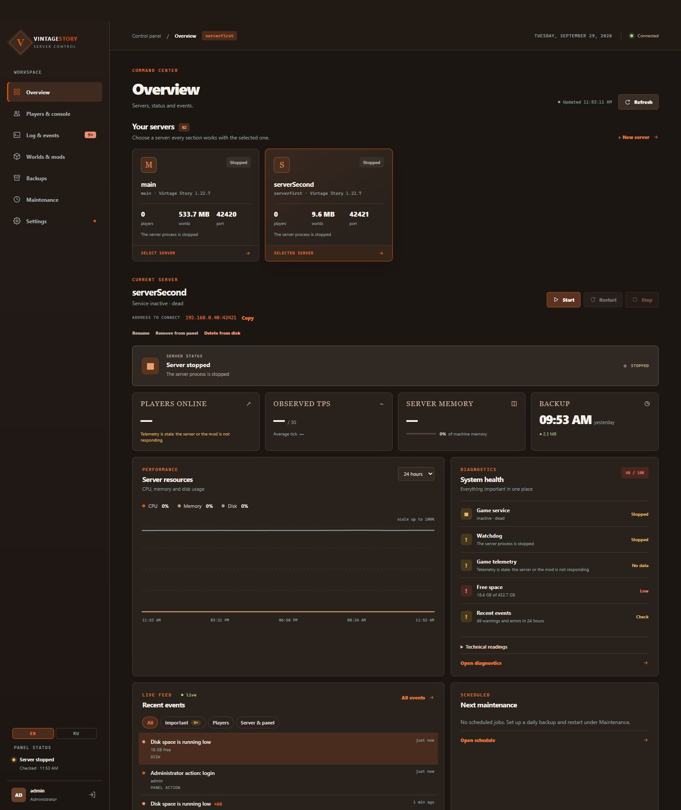
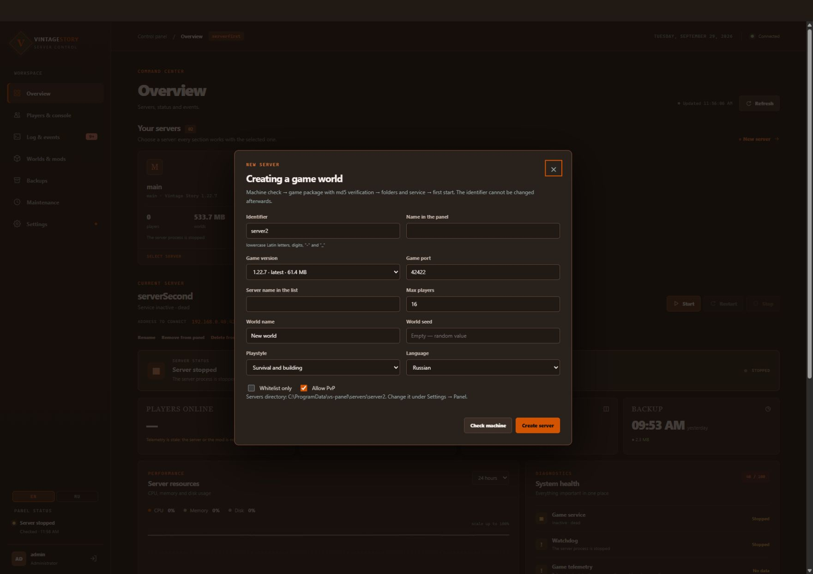
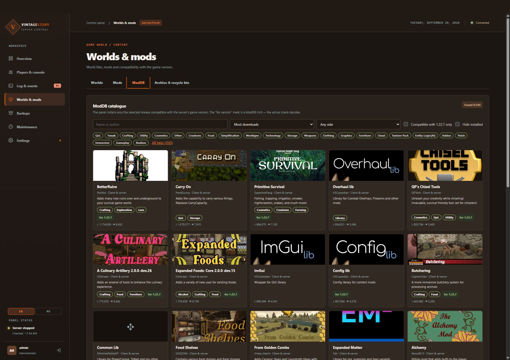
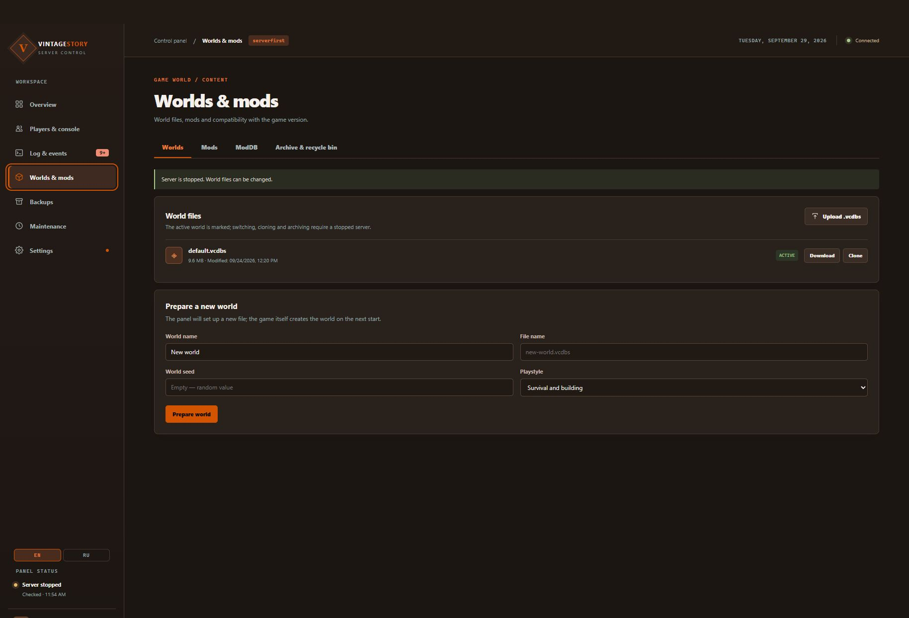
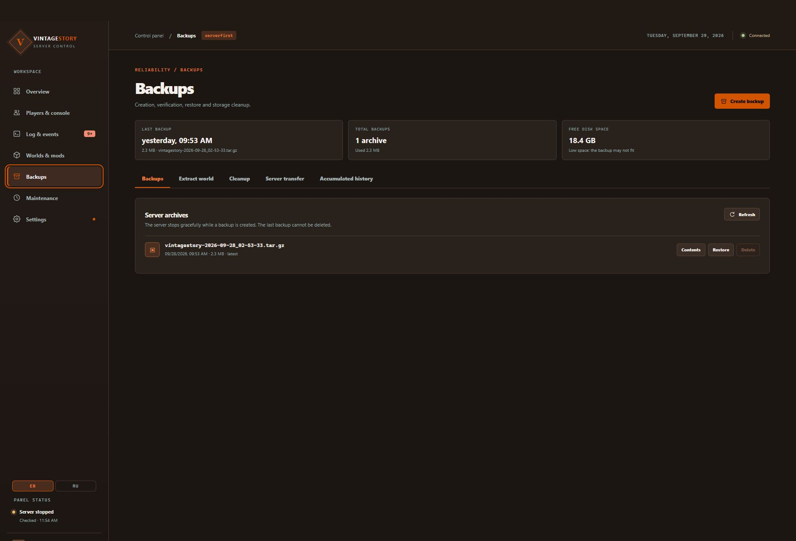
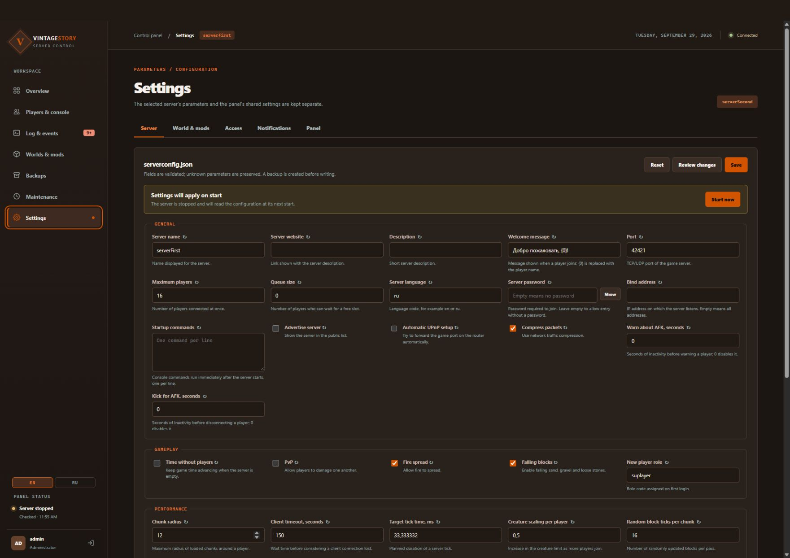

# Vintage Story Panel — установка и использование

Панель управляет серверами Vintage Story через браузер: запускает игру, устанавливает моды, хранит миры и резервные копии.

На скриншотах интерфейс английский. Переключить его на русский можно кнопкой **EN / RU** внизу левого меню. Английские названия кнопок ниже помогут найти их на изображениях.

## Содержание

- [Как получить и установить панель](#как-получить-и-установить-панель)
- [Первый вход](#первый-вход)
- [Создание и запуск сервера](#создание-и-запуск-сервера)
- [Моды и миры](#моды-и-миры)
- [Резервные копии](#резервные-копии)
- [Настройки и повседневное управление](#настройки-и-повседневное-управление)
- [Если что-то не работает](#если-что-то-не-работает)

## Как получить и установить панель

Устанавливайте панель на машину, где будет работать игровой сервер. Нужны интернет, свободное место для игры и миров, права администратора.

Поддерживаются **Windows 10/11 или Windows Server x64** и **Linux x64/ARM64 с systemd**. На Windows используйте локальный диск NTFS. На Linux нужна утилита `setpriv` из пакета `util-linux`. Устанавливать .NET для самой панели отдельно не нужно.

### Установка одной командой

Эти команды сами загрузят последний выпуск и запустят установщик. Скачивать архив вручную не нужно.

**Windows, PowerShell:**

```powershell
irm https://raw.githubusercontent.com/ruslan120p/vintage-story-panel-net/master/deploy/windows/get.ps1 | iex
```

**Linux, терминал:**

```sh
curl -fsSL https://raw.githubusercontent.com/ruslan120p/vintage-story-panel-net/master/deploy/get.sh | sudo sh
```

После запуска выберите каталог для игровых серверов и завершите первый вход по инструкции ниже.

### Ручная установка: скачать выпуск

1. Откройте [страницу выпуска 0.3.0 на GitHub](https://github.com/ruslan120p/vintage-story-panel-net/releases/tag/v0.3.0).
2. Разверните список **Assets** и скачайте архив для своей системы:

| Система | Архив |
|---|---|
| Windows x64 | `vs-panel-win-x64.zip` |
| Linux x64 | `vs-panel-linux-x64.tar.gz` |
| Linux ARM64 | `vs-panel-linux-arm64.tar.gz` |

Выбирайте готовый архив панели, а не **Source code**.

#### Windows

1. Распакуйте ZIP целиком в отдельную папку.
2. Откройте вложенную папку `vs-panel-win-x64` и запустите **install.cmd** двойным щелчком. Подтвердите запрос Windows на права администратора.
3. Выберите папку для игровых серверов, например `D:\vs-servers`. Используйте новую пустую папку без пробелов в пути. Отмена выбора оставляет стандартную папку `C:\ProgramData\vs-panel\servers`.
4. Дождитесь завершения. Установщик подготовит панель и первый сервер, создаст службы и откроет браузер с мастером установки.

#### Linux

Перенесите скачанный архив на сервер. Для x64 выполните в папке с архивом:

```sh
tar -xzf vs-panel-linux-x64.tar.gz
cd vs-panel-linux-x64
sudo sh install.sh
```

Для ARM64 замените `linux-x64` на `linux-arm64` в первых двух командах.

Установщик спросит, где хранить игровые серверы. Нажмите Enter для стандартного каталога `/srv/vs-panel` или укажите свой. Дождитесь завершения и откройте ссылку на мастер, которую выведет установщик. Если сервер без рабочего стола, откройте сетевую ссылку на другом компьютере.

## Первый вход

1. Откройте **одноразовую ссылку из установщика**. Она даёт доступ к первоначальной настройке — не передавайте её другим людям.
2. Создайте администратора: задайте имя пользователя и пароль.
3. Подтвердите настройки доступа к панели. Для начала можно оставить предложенные значения.
4. Завершите настройку первого игрового сервера, если мастер предлагает этот шаг.
5. После завершения войдите созданной учётной записью.

Если ссылка потерялась до завершения мастера, получите новую: на Linux выполните `sudo vs-panel access`, на Windows — `vs-panel access` в терминале от имени администратора.

В дальнейшем открывайте `http://localhost:8080` на самой машине или `http://<IP сервера>:8080` из локальной сети. Например: `http://192.168.0.40:8080`. Если выбрали другой порт, используйте его. Для работы через интернет настройте внешний доступ отдельно; подробности есть в [README](../README.ru.md).

## Создание и запуск сервера

В **Overview** нажмите карточку нужного сервера. Остальные разделы будут работать именно с ним.



Если сервер уже создан установщиком, выберите его и нажмите **Start**. Дождитесь готовности и скопируйте **ADDRESS TO CONNECT**: это адрес для подключения в игре. Адрес веб-панели для подключения в Vintage Story не подходит.

**Stop** останавливает игру, **Restart** перезапускает её.

Под списком серверов находится карточка **MACHINE** — сводка о компьютере, на котором стоит панель:

- загрузка процессора, а на Linux ещё и средняя нагрузка за 1, 5 и 15 минут;
- занятая и доступная память, подкачка;
- свободное место на дисках, где лежат панель, данные серверов и резервные копии; под каждым диском подписано, что на нём;
- время работы машины и память, которую занимает сама панель.

Значок в углу карточки показывает общую оценку. **Running low** означает, что память или один из дисков заполнены на 75 % и больше, **Out of resources** — на 90 % и больше. Освободите место или память до того, как игра начнёт тормозить или не сможет сохранить мир. Карточка обновляется каждые 15 секунд.

Чтобы добавить ещё один сервер:

1. Нажмите **+ New server**.
2. Введите идентификатор латиницей и имя сервера.
3. Выберите версию игры и свободный игровой порт. У каждого сервера должен быть свой порт.
4. Укажите число игроков, имя мира и режим игры. Seed можно оставить пустым.
5. Нажмите **Check machine**, затем **Create server** и дождитесь завершения.



## Открыть сервер игрокам из интернета

Панель сама открывает игровой порт в брандмауэре машины при создании сервера, переносит правило при смене **Port** в настройках сервера и снимает его при удалении сервера. На Linux это работает, если включён ufw. Если открыть порт не удалось, панель покажет причину: тогда откройте порт вручную.

Панель не видит двух вещей, их настройте сами:

- **роутер** дома: пробросьте игровой порт (TCP и UDP) на машину с сервером;
- **брандмауэр провайдера VPS** («группы безопасности», «Firewall» в панели провайдера): откройте игровой порт (TCP и UDP) и порт панели.

Игроки подключаются в игре через «Мультиплеер → Добавить сервер» по адресу из **ADDRESS TO CONNECT**, например `203.0.113.10:42420`.

Саму панель можно открыть в интернет по IP-адресу, по домену или по домену с HTTPS. Как это сделать и чем варианты отличаются по безопасности, описано в разделе [Публикация в интернете](../README.ru.md#публикация-в-интернете) README. Если открываете панель без HTTPS, включите двухфакторный вход и не заходите в неё из публичных сетей.

Нет белого IP-адреса (провайдер выдаёт адрес за общим NAT)? Панель можно открыть через Tailscale или Cloudflare Tunnel — см. [Дома за NAT, без белого IP](../README.ru.md#дома-за-nat-без-белого-ip). Игрокам туннель не поможет: для публичного сервера нужен проброс игрового порта или VPS.

## Моды и миры

### Установить мод

1. Выберите сервер и остановите игру.
2. Откройте **Worlds & mods → ModDB**.
3. Найдите мод и откройте его карточку.
4. Выберите выпуск, совместимый с версией игры, и подтвердите установку.
5. Запустите сервер.

Установленные моды находятся во вкладке **Mods**. Сохраните **VS Panel Telemetry**: он передаёт панели сведения об игроках и состоянии игры.



### Использовать свой мир

Остановите игру и откройте **Worlds & mods → Worlds**. Загрузите сохранение кнопкой **Upload .vcdbs**, выберите его как активный мир и снова запустите сервер. Метка **ACTIVE** показывает выбранный мир. **Download** скачивает сохранение, **Clone** создаёт его копию.

Для нового мира заполните поля в **Prepare new world** и нажмите **Prepare world**. Сам мир будет создан при следующем запуске игры.



## Резервные копии

Перед обновлением игры, сменой мира или важными изменениями создавайте копию.

1. Остановите сервер.
2. Откройте **Backups** и создайте резервную копию.
3. Дождитесь завершения. Скачайте важную копию на другую машину.

**Contents** показывает состав архива, **Download** скачивает его. Для восстановления остановите сервер, выберите копию и нажмите **Restore**. Восстановление заменяет текущие данные — проверьте выбранный сервер и дату копии перед подтверждением.



## Настройки и повседневное управление

В **Settings → Server** меняются название, число игроков, пароль и другие параметры. После правки нажмите **Review changes**, проверьте список и сохраните. Если панель показывает, что нужен перезапуск, перезапустите сервер.



Другие полезные разделы:

- **Players & console** — игроки, чат и игровые команды. Выберите готовую команду в **Command catalogue** и нажмите **Send command**. Консоль работает при запущенной игре.
- **Maintenance → Schedule** — перезапуск по расписанию с предупреждением игроков и резервной копией. Время задаётся по часам машины сервера.
- **Maintenance → Updates** — проверка и установка обновлений игры и модов. Перед обновлением сохраните резервную копию и прочитайте описание выбранной версии.
- **Access** — дополнительные учётные записи и роли. Выдавайте каждому человеку отдельную учётную запись; для администратора можно включить TOTP.
- **Access → API tokens** — токены для скриптов и мониторинга (Prometheus, Grafana). Токен показывается один раз, сохраните его сразу: выход или новый вход очищает показанный секрет. Для мониторинга достаточно роли **Viewer**. Подробнее — [API-токены и Prometheus](../README.ru.md#api-токены-и-prometheus).
- **Notifications** — уведомления о событиях сервера. Укажите нужный канал, сохраните настройки и отправьте тестовое уведомление.

Саму панель обновляет команда `sudo vs-panel update` на Linux или `vs-panel update` в командной строке администратора на Windows. Учётные записи, серверы и настройки сохраняются; вернуть прежнюю версию можно командой `vs-panel rollback`.

## Если что-то не работает

| Проблема | Что проверить |
|---|---|
| Не открывается панель | Адрес и порт из установщика, работа служб панели, доступ между компьютерами. |
| Игра не запускается или не становится готовой | Откройте **Diagnostics** и **Server log**, прочитайте причину. |
| Нет свежей телеметрии | Запущена ли игра и установлен ли **VS Panel Telemetry**. У остановленного сервера свежих данных нет. |
| Игроки не могут подключиться | Используют ли они **ADDRESS TO CONNECT**, доступен ли игровой порт. Для интернета проверьте перенаправление порта на роутере. |
| Кнопки недоступны | Выбран ли сервер, достаточно ли прав, не идёт ли другая операция. Некоторые действия требуют остановки игры. |
| Не хватает места | Скачайте нужные копии отдельно и удалите ненужные архивы через панель. |
| После обновления что-то работает не так | В диагностическом пакете (**Diagnostics**) раздел `agent`: если `same_build` — `false`, обновление не завершилось. Выполните `vs-panel repair` (на Linux — с `sudo`). |
| Скрипт с токеном получает «недоступно по API-токену» | Это действие требует входа в панель: учётные записи, токены, произвольная консоль, уведомления, мастер установки, каталог серверов, создание и удаление серверов. |

Если нужна помощь, сохраните текст ошибки и относящиеся к ней строки журнала. Пароли и одноразовые ссылки не публикуйте.
